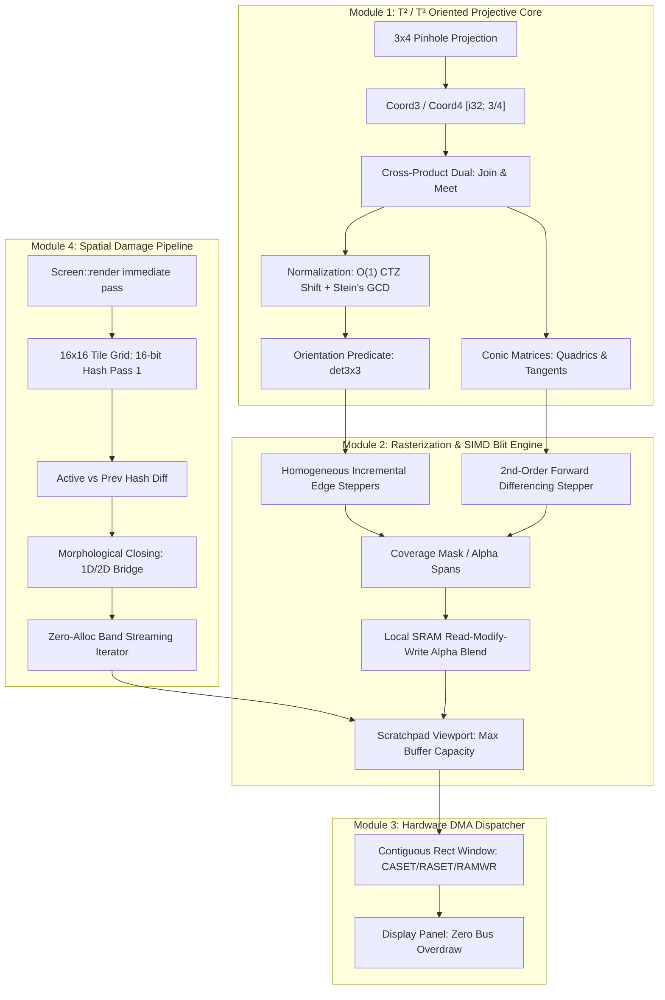
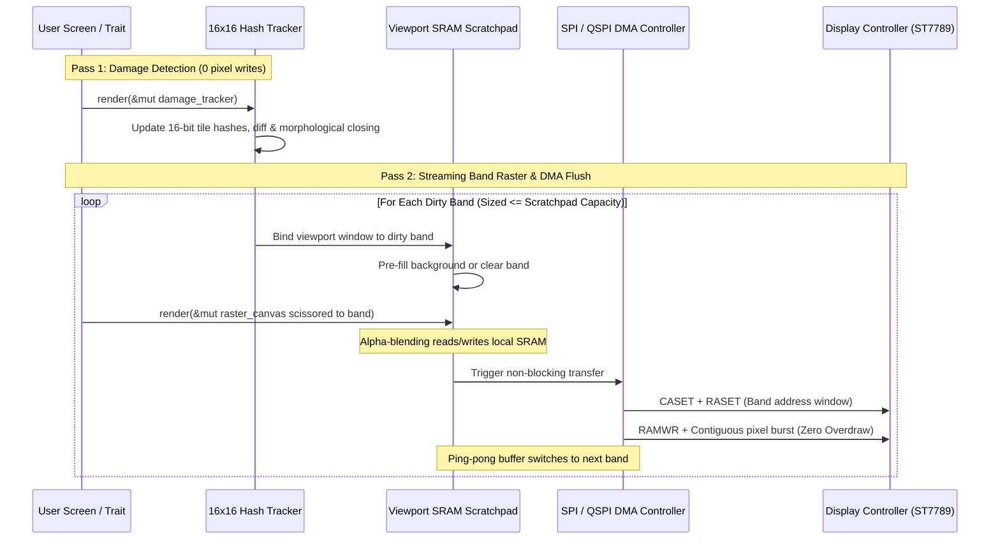

# Architecture Blueprint: A Unified Oriented-Projective 2D/3D Rendering Engine

**WARNING: AI generated. This document could be incorrect, inconsistent, and
confabulated. It is a synthesis of an architectural brainstorming session.
This warning can be removed after it's reviewed.**

## Motivation: Why This Changes the Paradigm

Traditional embedded graphics stacks are built on an unstable compromise. They typically choose between two flawed extremes:

1. **Low-level naive blitters (e.g., standard `embedded-graphics` drivers):** They lack scene graphs, have zero awareness of occlusion, and treat display buses as memory-mapped targets. They either generate massive bus overdraw by redrawing entire rectangular AABBs or degrade into pathological single-pixel command loops. Furthermore, they provide no unified mathematical framework for curves, perspective, or blending.
2. **Heavy retained-mode frameworks (e.g., LVGL, Skia subsets):** They drag in floating-point math, complex memory allocators, dynamic scene trees, and fragmented rasterizers that treat circles, lines, beziers, and affine transforms as completely unrelated geometric pipelines.

This architecture unifies geometric computing and embedded display constraints from first principles:

* **Algebraic Singularity Elimination ($\mathbb{T}^2 / \mathbb{T}^3$):** By founding the math on Jorge Stolfi’s oriented projective space using homogeneous integer coordinates (`[i32; 3]` and `[i32; 4]`), division is eliminated from the hot geometry path. Points, lines, conic sections (circles, ellipses, parabolas), and 3D pinhole projections use the same matrix-vector mechanics. Parallel lines, points at infinity, and back-facing geometry are natural coordinates rather than edge-case branches or floating-point division-by-zero panics.
* **Fast Bit-Growth Containment ($O(1)$ CTZ Shift + Stein's Binary GCD):** Coordinate scale is preserved across cascaded operations by exploiting the scale-invariance of homogeneous coordinates $(\lambda x, \lambda y, \lambda w) \equiv (x, y, w)$. Rapid $O(1)$ common trailing zero elimination (`(x | y | w).trailing_zeros()`) keeps coordinates compact on the hot path, with Stein's binary GCD acting as a fallback when bit-widths near overflow thresholds.
* **Hardware-True Bandwidth Minimization:** Display controllers (ST7789, ILI9341, etc.) demand contiguous rectangular streams. By combining a **16×16 spatial tile tracker using 16-bit hashing** with **morphological gap-filling (closing)**, the engine achieves the dirty-tracking fidelity of a 32-bit CRC in under **600 bytes of RAM**. Transient collisions are swallowed automatically by spatial coalescing, and lingering artifacts are eliminated by a resting settle timer.
* **Zero-`alloc` Two-Pass Streaming Pipeline:** Eliminates dynamic scene trees and command queues. A simple `Screen` trait is executed in two immediate-mode passes: Pass 1 generates damage hashes across the 16×16 grid (0 pixel writes); Pass 2 streams coalesced dirty bands directly into the local scratchpad for immediate non-blocking DMA dispatch.
* **Bounded Scratchpad Local Compositing:** By guaranteeing that all composited dirty regions are sliced into bands that fit strictly inside a small, relocatable **SRAM scratchpad** (e.g., 8–16 KB), the rasterizer performs fast read-modify-write in local RAM for alpha blending and anti-aliasing before streaming contiguous bursts over SPI/QSPI with zero bus overdraw.



---

## Module 1: The Algebraic Core ($\mathbb{T}^2$ and $\mathbb{T}^3$)

The foundation of the engine is an exact integer implementation of oriented projective space. It treats Euclidean space as a subset of the sphere $S^2$, differentiating between front-facing and antipodal directions.

### Core Primitives & Duality

* **`Coord3` Representation:** Homogeneous triple `[i32; 3]` representing $(x, y, w) \in \mathbb{Z}^3$.
  * $w > 0$: Finite point in front universe $(x/w, y/w)$.
  * $w < 0$: Antipodal point in rear universe.
  * $w = 0$: Directed point at infinity along vector $(x, y)$.
* **`Coord4` Representation:** Homogeneous quad `[i32; 4]` representing $[X, Y, Z, W]^T \in \mathbb{T}^3$. Stored as 4 contiguous `i32` elements to map directly to 128-bit SIMD registers (ARM NEON, x86 SSE/AVX, RISC-V Vector).

* **Dual Operation (`join_or_meet`):**
  * $\mathbf{l} = \mathbf{p}_1 \times \mathbf{p}_2$: Directed line connecting two points.
  * $\mathbf{p} = \mathbf{l}_1 \times \mathbf{l}_2$: Intersection point of two lines. Parallel lines intersect naturally at $w = 0$.

* **Bit-Growth Containment & Scale Invariance:**
  Because homogeneous coordinates in $\mathbb{T}^2$ are scale-invariant:
  $$(\lambda x, \lambda y, \lambda w) \equiv (x, y, w) \quad \text{for any } \lambda > 0$$
  Dividing all coordinates by a positive common factor preserves the exact oriented point and line equations without introducing floating-point or division-by-zero vulnerabilities.
  * **Hot-Path Reduction ($O(1)$ CTZ):**
    ```rust
    let common_zeros = (x | y | w).trailing_zeros();
    if common_zeros > 0 {
        x >>= common_zeros;
        y >>= common_zeros;
        w >>= common_zeros;
    }
    ```
    Compiles to a single `CLZ`/`CTZ` or `rbit` instruction on ARM Cortex-M and RISC-V.
  * **Overflow-Guard Reduction (Stein's Binary GCD):** If intermediate coordinates exceed a 24-bit magnitude before operations that square (such as determinant evaluation or dual meets), Stein's binary GCD algorithm extracts common non-power-of-two factors using shifts, subtractions, and bit tests exclusively.

* **Robust Predicates:**
  * Orientation test $\Delta(\mathbf{p}, \mathbf{q}, \mathbf{r}) = \det([\mathbf{p}, \mathbf{q}, \mathbf{r}])$ evaluated with 128-bit integer accumulators (`i128`). Returns strictly `CounterClockwise`, `Clockwise`, or `Collinear`. Exact integer arithmetic guarantees topological consistency.

### Unified Conic Pipeline

* **Conic Representation:** Symmetric $3 \times 3$ integer matrix $\mathbf{C}$:
  $$\mathbf{p}^T \mathbf{C} \mathbf{p} = 0$$
  Circles, ellipses, parabolas, and hyperbolas share this exact representation.
* **Inside/Outside Test:** Sign of $\mathbf{p}^T \mathbf{C} \mathbf{p}$ evaluated without square roots or trigonometric functions.
* **Tangent Lines:** Evaluated via $\mathbf{l} = \mathbf{C} \mathbf{p}$.
* **Tile-Bounded Rasterization via 2nd-Order Forward Differencing:**
  Because the spatial damage grid culls conics to active $16 \times 16$ tiles, the quadratic polynomial $Q(x, y) = \mathbf{p}^T \mathbf{C} \mathbf{p}$ is evaluated along scanlines using Bresenham-style incremental forward differences:
  $$Q(x + 1, y) = Q(x, y) + \Delta Q_x$$
  $$\Delta Q_x(x + 1) = \Delta Q_x(x) + 2A$$
  The inner pixel evaluation loop requires only **two integer additions per pixel**, with zero multiplications and zero square roots.

### Projective Maps ($\mathcal{M}_2$ and $\mathcal{M}_3$) & 3D Unification

Following Jorge Stolfi's definition of projective maps (Chapter 8):
A linear map $M$ induces a projective map $[\![M]\!]$ of oriented projective space $\mathbb{T}_\nu$ to itself ($\mathcal{M}_\nu$).
Unlike classical unoriented projective groups ($\mathrm{PGL}$) where $M$ and $-M$ are conflated, Stolfi's oriented projective maps distinguish orientations:
* **Orientation-Preserving:** When $\det(M) > 0$, mapping $\mathbb{T}_\nu \to \mathbb{T}_\nu$.
* **Orientation-Reversing:** When $\det(M) < 0$, mapping $\mathbb{T}_\nu \to \neg\mathbb{T}_\nu$.

The engine uses two square integer matrix primitives with `const fn multiply` for zero-overhead compile-time matrix composition:

* **Planar Projective Maps $\mathcal{M}_2$ (`Matrix3x3`):** Unified $3 \times 3$ integer matrices for 2D translation, rotation, scaling, and planar projective keystone warping.
* **3D Projective Maps $\mathcal{M}_3$ (`Matrix4x4`):** Unified $4 \times 4$ integer matrices for 3D Model, View, and Perspective Projection transforms:
  * Perspective projection maps $[X, Y, Z, W]^T \in \mathbb{T}^3$ into clip-space $[X', Y', Z', W']^T \in \mathbb{T}^3$.
  * Screen extraction takes $\text{screen} = \mathtt{Coord3::new}(X', Y', W')$, while retaining the clip depth $Z'$ and weight $W'$ for division-free painter's sorting via cross-multiplication:
    $$Z'_A \cdot W'_B > Z'_B \cdot W'_A$$

---

## Module 2: The Viewport Scratchpad & SIMD Rasterization Engine

This module transforms projective geometric representations into physical pixels inside a fixed-size, relocatable **SRAM scratchpad** (configurable, typically 8 KB to 16 KB, e.g., $128 \times 64$ at 16-bit RGB565).

### Incremental Edge Rasterization

* **Homogeneous Edge Equations:** For each triangle edge line $\mathbf{l} = [a, b, c]$, the edge distance function is:
  $$E(x, y) = a \cdot x + b \cdot y + c \cdot w$$
* **Zero-Multiplication Inner Loop:** Stepping along a horizontal scanline requires only integer additions:
  $$E(x + 1, y) = E(x, y) + a$$
  Stepping down a scanline requires:
  $$E(x, y + 1) = E(x, y) + b$$
* **Multi-Sample Coverage Masks:** For anti-aliasing without cracking seams on shared edges:
  * Interior pixels evaluate $E(x, y) \ge 0$ across all edges simultaneously.
  * Boundary pixels compute a 4-bit or 16-bit subpixel bitmask, mapping area coverage to alpha spans without expensive floating-point area clipping.

### Read-Modify-Write Local Alpha Blending

Because the scratchpad resides entirely in fast on-chip SRAM, blending transparent primitives requires zero external bus round-trips:
* Rasterization outputs horizontal spans: `Span { y, x_start, x_end, color, coverage_or_alpha }`.
* **Opaque Runs:** Contiguous pixels written via aligned 32-bit register stores (two RGB565 pixels per instruction).
* **Blended Runs (Read-Modify-Write):** Reads destination pixels directly from the local SRAM buffer, blends channels in parallel, and writes back.
* **Packed DSP Arithmetic (e.g., ARM Cortex-M4/M7/M33 SIMD, ESP32-S3 PIE):**
  Unpacks two RGB565 pixels into 32-bit registers across separated channels:
  $$\text{Masked Red/Blue: } (C \ \& \ \mathtt{0xF81F}), \quad \text{Masked Green: } (C \ \& \ \mathtt{0x07E0})$$
  Executes parallel multiply-accumulate with alpha factor $\alpha \in [0, 32]$:
  $$\text{Blended} = \left( \frac{\text{Src} \times \alpha + \text{Dst} \times (32 - \alpha)}{32} \right)$$
  Repacks and writes two pixels per cycle.

---

## Module 3: 16×16@16-Bit Spatial Damage Grid & Coalescer

This module tracks what changed between frames with minimal RAM and CPU overhead, completely eliminating redundant drawing passes.

### State Tracking Specifications

* **Tile Dimensions:** $16 \times 16$ pixels.
* **Storage Footprint:** For a $320 \times 240$ screen:
  $$\text{Grid Resolution} = 20 \times 15 = 300 \text{ tiles}$$
  $$\text{Hash Table Size} = 300 \times 2 \text{ bytes} = \mathbf{600 \text{ bytes of SRAM}}$$
* **Hash Accumulator:** A lightweight 16-bit additive hash or truncated Fletcher-16 updated as primitives touch tiles during the coarse layout pass.

### Morphological Coalescing (Hole-Filling)

Raw hash differences produce a sparse 2D bitmask of dirty tiles (`1` = changed, `0` = unchanged).

```
Raw Hash Diff (Collisions on 0*):       After 1-Pass Morphological Closing:
  [ 1 ] [ 1 ] [ 1 ] [ 1 ]                 [ 1 ] [ 1 ] [ 1 ] [ 1 ]
  [ 1 ] [ 0*] [ 1 ] [ 1 ]       --->      [ 1 ] [ 1 ] [ 1 ] [ 1 ]  <-- Bridged
  [ 0 ] [ 1 ] [ 0*] [ 1 ]                 [ 0 ] [ 1 ] [ 1 ] [ 1 ]  <-- Bridged
```

1. **1D Run Bridging:** Scans rows. If two dirty runs are separated by 1 or 2 clean tiles, bridge the gap into a continuous dirty span.
   * *Bandwidth Economics:* Over an external bus, issuing a new `CASET`/`RASET` command sequence costs $\approx 20\text{--}30\text{ bytes}$ of command overhead. Bridging a $16\text{ px}$ gap costs only 32 bytes of continuous streaming—making it cheaper to transmit than to interrupt.
2. **2D Bounding Box Merging:** Bounding boxes of nearby or adjacent spans are merged into minimal rectangular dirty windows.

### Collision Safety Guarantees

* **Interior Collisions:** Morphological closing swallows isolated undetected tiles. Two adjacent interior tiles must both collide simultaneously for a drop to occur ($P \approx 1/65536^2 \approx 2.3 \times 10^{-10}$, equivalent to 32-bit CRC protection).
* **Perimeter Collisions:** An edge collision on a resting frame has $P \le 0.003\%$.
* **Idle Settle Timer:** A $50\text{--}100\text{ ms}$ debounce timer fires after user input or animation ceases, issuing an unconditional refresh of the control's bounding envelope. This guarantees zero permanent artifacts when the screen is static.

---

## Module 4: Display Pipeline & Hardware DMA Orchestrator

This module maps dirty regions to the physical hardware bus using a zero-`alloc`, two-pass immediate execution loop.

### Zero-Allocation Streaming Loop (Option A)

Large coalesced dirty rectangles are split into bands sized to fit the available scratchpad capacity. This ensures the scratchpad buffer can be read during rasterization (essential for alpha blending / transparency) before sending it to the DMA controller.



### Execution Steps

1. **Pass 1 (Damage Detection):** 
   Call `screen.render(&mut damage_canvas)`. Primitives compute coarse bounding tiles and contribute to the 16-bit hash table. No pixels are rendered; execution runs in pure arithmetic.
2. **Coalescing & Streaming Bands:** 
   The damage grid diffs active vs previous hashes and runs morphological closing. An iterator/callback streams coalesced rectangles, automatically slicing any region that exceeds the scratchpad's capacity into scratchpad-sized horizontal bands.
3. **Pass 2 (Band Rasterization):**
   For each band:
   * Bind the scratchpad viewport origin to the band rect.
   * Scissor the canvas to the band rect.
   * Call `screen.render(&mut raster_canvas)`.
   * Transparent primitives read existing background pixels directly from local SRAM, compute packed SIMD alpha blends, and write back.
4. **DMA Dispatch:**
   * Transmit `CASET` and `RASET` once for the band window.
   * Dispatch the scratchpad buffer via non-blocking DMA (`RAMWR`).
   * The CPU immediately proceeds to rasterize the next band into the alternate ping-pong slice of the scratchpad.

---

## Module 5: High-Level API Architecture & Ecosystem Interop

To ensure rapid development and familiarity without compromising the low-level engine, the API is organized around simple traits and bridges.

### Core Traits

```rust
/// Represents a drawable screen, component, or view.
pub trait Screen {
    /// Renders components onto the supplied canvas.
    /// In Pass 1, Canvas is DamageTracker (recording hashes).
    /// In Pass 2, Canvas is RasterCanvas (rendering scissored pixels).
    fn render<C: Canvas>(&self, canvas: &mut C);
}

/// Drawing interface supporting projective primitives and conics.
pub trait Canvas {
    type Color;

    /// Set current transformation matrix (projective map M_2)
    fn set_transform(&mut self, transform: &Matrix3x3);

    /// Draw oriented projective triangle
    fn draw_triangle(&mut self, p1: Coord3, p2: Coord3, p3: Coord3, color: Self::Color);

    /// Draw conic section (circle, ellipse, quadric)
    fn draw_conic(&mut self, conic: &ConicMatrix, bounds: Rect, color: Self::Color);

    /// Draw anti-aliased projective polygon
    fn fill_polygon(&mut self, vertices: &[Coord3], color: Self::Color);
}
```

### `embedded-graphics` Interop Bridge

To leverage existing embedded fonts, icons, and display widgets:
* The engine provides a blanket `DrawTarget` implementation for `Canvas`:
  ```rust
  impl<C: Canvas<Color = Rgb565>> embedded_graphics::draw_target::DrawTarget for C {
      type Color = Rgb565;
      type Error = core::convert::Infallible;
      // Maps pixel/iter/span drawing directly into canvas spans
  }
  ```
* Standard `embedded-graphics` primitives (`Text`, `Image`, `Line`, `Rectangle`) can be drawn directly into the projective `Canvas` inside any `Screen::render` implementation.

---

## Implementation Roadmap

| Phase | Milestone | Deliverables / Acceptance Criteria |
| --- | --- | --- |
| **Phase 1** | **Projective Math Core (`no_std`)** | • `Coord3` (`[i32; 3]`) and `Coord4` (`[i32; 4]`) types with dual `join_or_meet` operator.<br><br>• $O(1)$ trailing zeros bit-shift + Stein's binary GCD coordinate normalization.<br><br>• Exact 128-bit determinant `ccw` orientation predicate.<br><br>• Conic matrix evaluation, tangent lines, and 2nd-order forward difference steppers.<br><br>• Unit tests verifying zero division and correct handling of points at infinity. |
| **Phase 2** | **Damage Grid & Coalescer** | • $16 \times 16$ grid with 16-bit hash table ($600\text{ B}$ footprint for $320 \times 240$).<br><br>• 1D run bridge and 2D bounding box merger.<br><br>• Zero-alloc streaming callback/iterator (`for_each_band`) that splits large rects to scratchpad capacity.<br><br>• Idle settle debounce timer logic.<br><br>• Test suite validating absorption of artificial hash collisions. |
| **Phase 3** | **Scratchpad Rasterizer & SIMD** | • Configurable SRAM scratchpad viewport supporting arbitrary sub-window offsets.<br><br>• Incremental edge equation rasterizer for triangles and conics with 2nd-order differencing.<br><br>• Packed RGB565 SIMD/DSP local SRAM read-modify-write alpha blending routines.<br><br>• Subpixel edge coverage mask calculation. |
| **Phase 4** | **High-Level API & Hardware Driver Integration** | • `Screen` and `Canvas` traits with immediate-mode two-pass pipeline.<br><br>• `embedded-graphics` `DrawTarget` interop adapter for fonts and assets.<br><br>• ST7789/ILI9341 SPI/QSPI driver integration with ping-pong DMA buffers.<br><br>• Interactive PoC demo (animated gauge with transparent needle and rotating 3D wireframe).<br><br>• Bus utilization benchmark: measure overdraw reduction vs standard blitting. |
